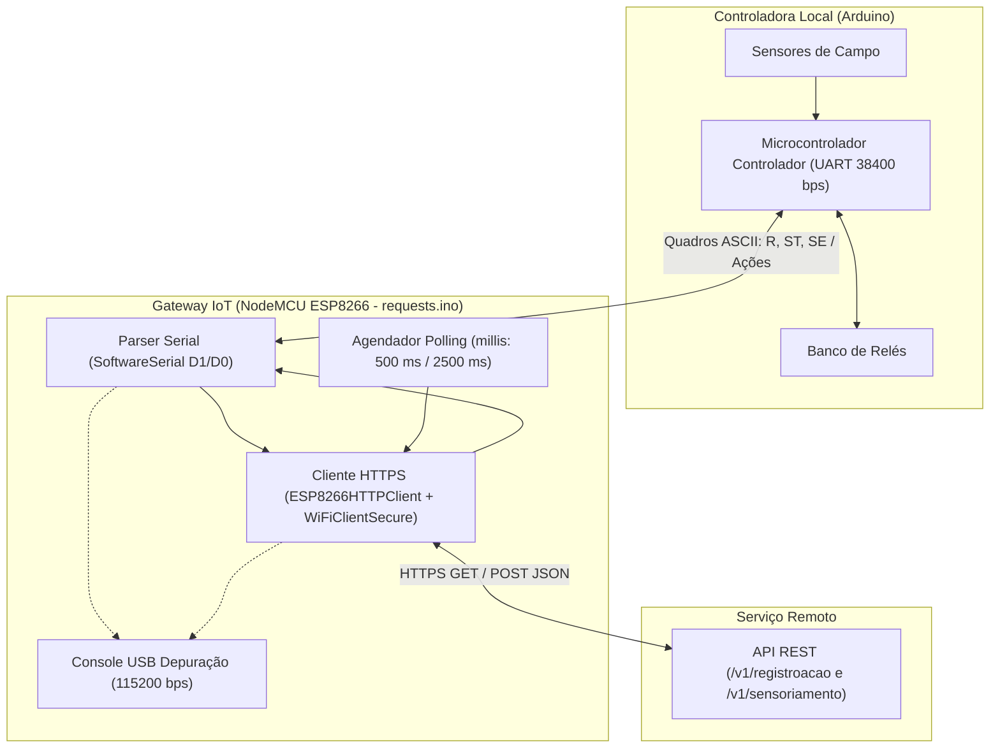
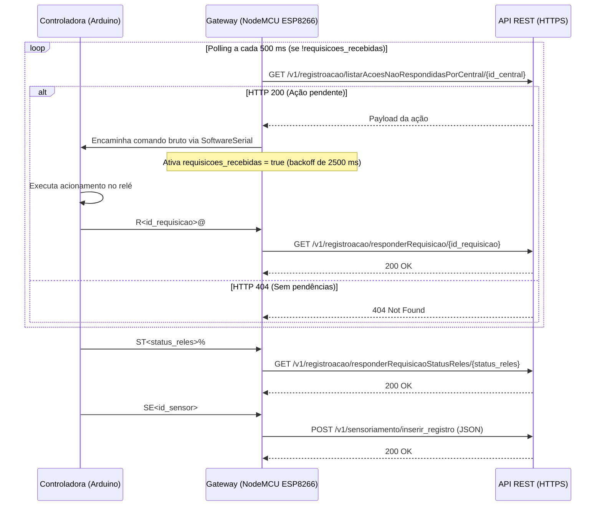

# Gateway Serial-para-HTTPS REST com NodeMCU ESP8266

Firmware embarcado para **NodeMCU ESP8266** atuando como gateway bidirecional entre uma controladora auxiliar (Arduino) conectada via UART (`SoftwareSerial` a `38400 bps`) e uma **API REST sobre HTTPS**, implementando polling adaptativo de comandos remotos (`GET`), confirmação de atuação em relés (`ACK`), reporte de estado e envio de telemetria de sensores via `POST` em formato JSON.

[-2B4C7E?style=flat-square)](#protocolo-serial-e-endpoints-rest)

O projeto desacopla a pilha de rede Wi-Fi/TLS/HTTP da lógica de sensores e atuadores de um microcontrolador sem conectividade nativa, expondo um protocolo ASCII leve e determinístico que traduz quadros seriais em requisições REST autenticadas na nuvem.

---

## Sumário

1. [Objetivo](#objetivo)
2. [Justificativa Técnica](#justificativa-técnica)
3. [Cenários de Uso](#cenários-de-uso)
4. [Arquitetura e Fluxo de Comunicação](#arquitetura-e-fluxo-de-comunicação)
5. [Protocolo Serial e Endpoints REST](#protocolo-serial-e-endpoints-rest)
6. [Hardware e Mapeamento de Pinos](#hardware-e-mapeamento-de-pinos)
7. [Configuração e Estrutura do Repositório](#configuração-e-estrutura-do-repositório)
8. [Contato](#contato)
9. [Stack Técnica e Tecnologias Utilizadas](#stack-técnica-e-tecnologias-utilizadas)

---

## Objetivo

Fornecer um módulo de conectividade reutilizável baseado em **NodeMCU ESP8266** capaz de integrar placas Arduino ou controladoras legadas a serviços web modernos via **HTTP/HTTPS**, cumprindo quatro funções essenciais:

- Consultar continuamente uma fila remota de ações pendentes para a central (`id_central`) via `HTTP GET` e encaminhá-las pela interface serial ao microcontrolador de campo.
- Receber confirmações de execução de comandos de relé (`R<id>@`) e fechar o ciclo transacional na API por meio de endpoint de resposta dedicado.
- Reportar o estado consolidado dos relés (`ST<status>%`) à aplicação servidora sob demanda.
- Serializar leituras de sensores recebidas via UART (`SE<id_sensor>#<valor>@`) em corpo JSON e enviá-las por `HTTP POST` ao endpoint de sensoriamento.

---

## Justificativa Técnica

Em sistemas de automação baseados em microcontroladores AVR (como Arduino Uno/Mega), adicionar conectividade Wi-Fi com suporte a **TLS/HTTPS** e manipulação de APIs REST diretamente no controlador principal é inviável por restrições de RAM, Flash e ausência de pilha TCP/IP.

- **Offloading de conectividade com ESP8266 + `WiFiClientSecure`:** transferir toda a negociação Wi-Fi, encapsulamento TLS e requisições `ESP8266HTTPClient` para o NodeMCU libera o microcontrolador principal para tarefas determinísticas de leitura de sensores e chaveamento de cargas.
- **Protocolo ASCII enxuto na UART (`38400 bps`):** delimitar quadros com prefixos (`R`, `ST`, `SE`) e terminadores (`#`, `@`, `%`) elimina a necessidade de o Arduino montar ou interpretar objetos JSON, reduzindo drasticamente o consumo de SRAM no lado escravo.
- **Polling não bloqueante com janela adaptativa de espera (*backoff*):** o laço principal opera com temporização via `millis()` sem `delay()`, consultando a API a cada `500 ms` em regime ocioso e pausando automaticamente por `2500 ms` (`intervalo_handle_acao + 2000`) assim que uma ação é recebida e despachada ao Arduino, evitando reenvios duplicados enquanto o atuador processa o comando.
- **Separação entre console de depuração e barramento de dados:** o uso de `SoftwareSerial` (`D1`/`D0` a `38400 bps`) preserva a UART física USB (`Serial` a `115200 bps`) livre para monitoramento em tempo real de respostas HTTP e diagnósticos de campo.

---

## Cenários de Uso

- **Automação residencial e predial baseada em Arduino:** acionamento remoto de relés (iluminação, bombas, travas ou irrigação) com confirmação explícita de execução e consulta de estado via aplicativo web/mobile.
- **Retrofitting IoT de controladoras seriais existentes:** adição de conectividade Wi-Fi/HTTPS a placas já desenvolvidas sem redesenhar o firmware principal, exigindo apenas a emissão de quadros ASCII pela porta serial.
- **Telemetria de sensores em nuvem:** envio estruturado (`POST` JSON) de medições de temperatura, nível, vazão ou corrente adquiridas por um Arduino para APIs REST em nuvem ou servidores locais.
- **Protótipos de integração com APIs HTTPS por túnel reverso ou servidor local:** base de referência pronta para testar clientes `GET` e `POST` com `WiFiClientSecure` no ecossistema ESP8266.

---

## Arquitetura e Fluxo de Comunicação

O NodeMCU opera como ponte ativa entre o barramento serial local (`SoftwareSerial`) e a API remota (`HTTPS`), alternando de forma não bloqueante entre a escuta de quadros provenientes do Arduino e o polling de ações pendentes na nuvem.

### Sequência Operacional (Downlink com Backoff e Uplink de ACK / Telemetria)

---

## Protocolo Serial e Endpoints REST

### Quadros Seriais (`Arduino ↔ NodeMCU` @ `38400 bps`)

| Direção | Formato do Quadro | Exemplo | Função no Gateway (`requests.ino`) |
| :--- | :--- | :--- | :--- |
| `Arduino → NodeMCU` | `R<id_requisicao>@` | `R42@` | Extrai `id_requisicao` e chama `responderRequisicao()` confirmando a ação de relé |
| `Arduino → NodeMCU` | `ST<resposta>%` | `ST1010%` | Extrai a string de estado dos relés e chama `responderRequisicaoStatusReles()` |
| `Arduino → NodeMCU` | `SE<id_sensor>#<valor>@` | `SE3#24.8@` | Extrai `id_sensor` e `valor` e envia JSON via `registrar_sensoriamento()` |
| `NodeMCU → Arduino` | `<payload_api>` | Resposta da fila REST | Repassa integralmente o corpo retornado por `handleRele()` via `mySerial.println()` |

### Mapeamento de Endpoints REST

Todas as requisições incluem o cabeçalho `content-type: application/json` e trafegam sobre `WiFiClientSecure`.

| Função no Firmware | Método | Caminho (`{BASE_URL}/...`) | Corpo / Parâmetros |
| :--- | :--- | :--- | :--- |
| `handleRele()` | `GET` | `v1/registroacao/listarAcoesNaoRespondidasPorCentral/{id_central}` | Parâmetro de rota `id_central`; trata `HTTP 404` como fila vazia |
| `responderRequisicao(id)` | `GET` | `v1/registroacao/responderRequisicao/{id}` | Parâmetro de rota `id` da ação executada |
| `responderRequisicaoStatusReles(resp)` | `GET` | `v1/registroacao/responderRequisicaoStatusReles/{resposta}` | Parâmetro de rota com o estado reportado dos relés |
| `registrar_sensoriamento(id, valor)` | `POST` | `v1/sensoriamento/inserir_registro` | JSON: `{"id_sensor":"<id>", "valor":"<valor>"}` |

> [!IMPORTANT]
> **Validação TLS em produção:** o firmware utiliza `wifiClient.setInsecure()` para facilitar testes rápidos com servidores de desenvolvimento e túneis reversos sem exigir provisionamento prévio de certificados. Em implantações produtivas, substitua essa chamada pela validação do certificado raiz da CA (`BearSSL::X509List` / `setTrustAnchors()`) ou *fingerprint* do servidor.

---

## Hardware e Mapeamento de Pinos

| Pino NodeMCU | GPIO ESP8266 | Função | Parâmetros / Conexão |
| :--- | :--- | :--- | :--- |
| `D1` | `GPIO5` | `SoftwareSerial RX` | Conectar ao pino `TX` da placa Arduino (`38400 bps`) |
| `D0` | `GPIO16` | `SoftwareSerial TX` | Conectar ao pino `RX` da placa Arduino (`38400 bps`) |
| `USB (TX0/RX0)` | `GPIO1` / `GPIO3` | Console de Depuração | `Serial.begin(115200)` para logs de Wi-Fi, UART e HTTP |
| `GND` | `GND` | Referência Comum | Interligar obrigatoriamente ao `GND` do Arduino |

> [!WARNING]
> **Adaptação de nível lógico (`5 V` vs. `3,3 V`):** o NodeMCU ESP8266 opera em nível lógico de `3,3 V`. Ao conectar um Arduino de `5 V`, utilize um conversor de nível lógico ou divisor resistivo na linha `Arduino TX → NodeMCU D1 (RX)` para preservar a integridade elétrica do pino.

---

## Configuração e Estrutura do Repositório

### Dependências (Arduino IDE / PlatformIO)

- Core **ESP8266 for Arduino** (`ESP8266WiFi`, `ESP8266HTTPClient`, `WiFiClientSecure`, `WiFiUdp`)
- `SoftwareSerial` (`EspSoftwareSerial`, inclusa no pacote ESP8266)

### Passos de Configuração

1. Abra [requests.ino](./requests.ino) e configure `SSID`, `PASSWORD`, `id_central` e `BASE_URL` conforme o ambiente (recomenda-se mover credenciais para um arquivo `secrets.h` ignorado pelo Git).
2. Ajuste `intervalo_handle_acao` (padrão `500 ms`) caso deseje maior ou menor frequência de polling na API.
3. Grave o firmware no NodeMCU ESP8266, interligue `D1`/`D0` e `GND` à controladora Arduino configurada a `38400 bps` e acompanhe o status pelo Monitor Serial em `115200 bps`.

### Estrutura de Arquivos

| Arquivo | Descrição |
| :--- | :--- |
| [requests.ino](./requests.ino) | Firmware completo do gateway NodeMCU ESP8266 com conexão Wi-Fi, parser serial ASCII, polling adaptativo e cliente HTTPS (`GET`/`POST` JSON) |
| [README.md](./README.md) | Documentação técnica de arquitetura, protocolo serial, endpoints REST e hardware |

---

## Contato

- **Autor:** Aislan Silva Costa
- **E-mail:** [comprasaislan@gmail.com](mailto:comprasaislan@gmail.com)
- **LinkedIn:** [linkedin.com/in/aislan-silva-costa-660814341](https://www.linkedin.com/in/aislan-silva-costa-660814341/)

---

## Stack Técnica e Tecnologias Utilizadas

| Categoria | Itens |
| :--- | :--- |
| **Hardware** | `NodeMCU ESP8266` `Controladora Arduino (parceira UART)` |
| **Protocolos** | `HTTP` `HTTPS (TLS)` `REST` `JSON` `UART (SoftwareSerial 38400 bps)` `Wi-Fi` |
| **Tecnologias** | `C++ (Arduino)` `ESP8266WiFi` `ESP8266HTTPClient` `WiFiClientSecure` `EspSoftwareSerial` `Polling Não Bloqueante (millis)` |
